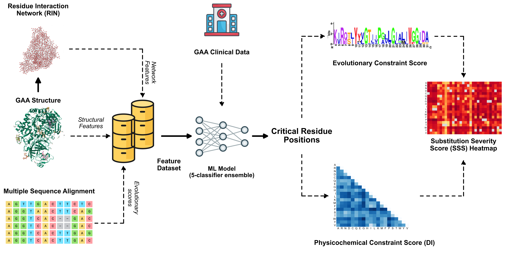

# Pompe-GAA-Hotspots

Code and data for **"Uncovering novel pathogenic hotspots in the Pompe disease target using graph-based features and ensemble machine learning"** (Sreeharsh K, Manjari Kiran, Mohd. Akif; University of Hyderabad).



We map human lysosomal acid α-glucosidase (GAA; PDB 5NN3) onto a residue interaction network, combine network, structural and conservation features in five classifiers to prioritise disease-relevant residue positions, and score individual substitutions with a Substitution Severity Score (SSS).

## Key results

- **844 residues**, 214 reported mutation positions; HDHB residues are enriched for mutations (51% vs 25%)
- **Classifiers** (nested CV): ROC AUC 0.77–0.80
- **52 novel consensus hotspots** across all five GAA domains
- **SSS** benchmark on 102 ClinVar variants: AUC 0.953, comparable to AlphaMissense (0.969), ESM-1v (0.947) and EVE (0.936)

## Run

```bash
conda env create -f environment.yml
conda activate gaa-hotspot
pip install -e .
./run_all.sh        # ~45 min; regenerates all results
```

## Contents

| Folder | |
|---|---|
| `data/raw/` | Input data (sources in `data/raw/README.md`) |
| `src/`, `scripts/` | Analysis code; pipeline stages 01–11 |
| `notebooks/` | Step-by-step notebooks |
| `results/figures/` | Main and supplementary figures |
| `results/supplementary/paper/` | Supplementary Information of the paper |
| `results/RESULTS_REPORT.md` | All reported numbers |
